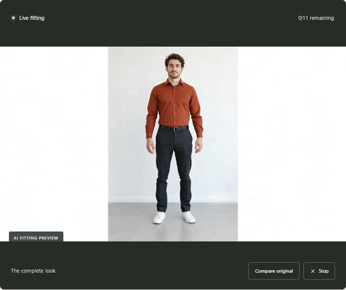

# WearOn

WearOn is a privacy-conscious virtual fitting studio: choose a garment, open a camera preview, and start a short interactive fitting session. I built it as a product-quality prototype around a replaceable inference boundary, rather than coupling the application to one model runtime.



## What this demonstrates

- A polished responsive product flow built with Next.js and React
- Camera lifecycle management, timeout handling, cleanup, and interruption recovery
- Catalog filtering, personal garment uploads, image validation, resizing, and prompt controls
- Signed HttpOnly sessions, strict origin checks, bounded short-lived access tokens, and rate limits
- Persistent SQLite usage controls for a cost-sensitive interactive service
- A replaceable fitting-backend boundary designed for a future self-hosted model
- Automated API, policy, lifecycle, catalog, and connection regression checks

## Architecture

```text
Browser
  ├─ local camera preview + garment preparation
  ├─ signed invitation session
  └─ short-lived fitting session
          │
Next.js application
  ├─ access and origin validation
  ├─ rolling usage limits in SQLite
  └─ scoped token exchange
          │
Replaceable fitting backend
```

The public repository includes the application, security controls, the test suite, and the backend contract. The inference runtime it calls is not published: the public build expects a compatible adapter at `globalThis.WearOnFittingBackend`, which is what keeps the integration replaceable and keeps deploy-specific code out of the public history.

## Run locally

Requires Node.js 22.13 or newer.

```bash
npm ci
cp .env.example .env.local
npm run dev
```

Set a long `SESSION_SECRET`, a demo access code, and your own fitting-token endpoint. The token endpoint contract is documented by `app/api/token/route.js` and covered by `test/api.test.mjs`.

## Verify

```bash
npm test
npm run build
```

The test suite exercises authentication, origin boundaries, signed-cookie validation, rolling usage limits, catalog assets, image constraints, connection metrics, and late-resource cleanup.

## Product decisions

- Video and uploaded garments are not persisted by WearOn.
- Audio capture is disabled.
- Each fitting session is limited to 15 seconds.
- Reference images are validated, bounded, resized without distortion, and encoded in the browser.
- A fitting preview is an appearance concept, not a sizing guarantee.

## More

- [Second fitting example](docs/screenshots/overshirt-result.png)
- [Sample garment provenance](public/garments/SOURCE.md)

Built by [Marwane Elhour](https://github.com/Marwanelh).
